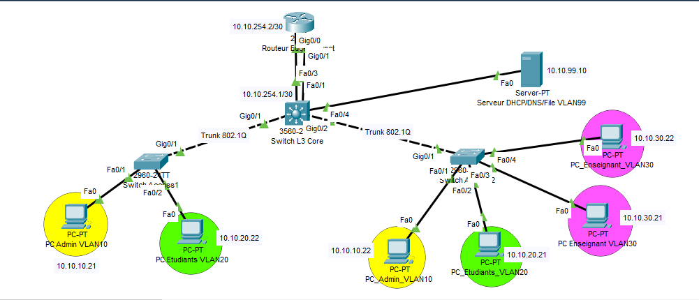

# Minicampus — réseau d'établissement avec VLAN, routage inter-VLAN, DHCP, DNS et ACL

> **Projet de groupe** (groupe 8, 6 étudiants) — Master 1 Systèmes, Réseaux et Infrastructures Virtuelles, Université Numérique Cheikh Ahmidou Kane, année 2024-2025, sous la direction de M. Ababacar Kane.
> Déploiement et simulation sous **Cisco Packet Tracer** d'un réseau de mini-campus segmenté en VLAN, avec cœur de réseau de niveau 3, services DHCP et DNS, filtrage par ACL, administration SSH et sortie Internet en NAT.

📄 **Rapport complet** : [`docs/rapport-minicampus-groupe8.pdf`](./docs/rapport-minicampus-groupe8.pdf)

## Ma contribution
*À COMPLÉTER : décrire à la première personne les parties que j'ai réalisées (ex. « J'ai configuré… »).*

## 1. Objectif
Déployer une infrastructure réseau complète pour un mini-campus : segmentation par VLAN, routage inter-VLAN, fourniture des services DHCP et DNS, et mesures de sécurité de base.

## 2. Topologie



Topologie en étoile : un switch cœur de niveau 3 (**CORE-SW**, Cisco 3560-24PS) relié par des **trunks 802.1Q** à deux switchs d'accès (**Access1** et **Access2**, Cisco 2960-24TT). Le routeur Edge (Cisco 2901) est relié au cœur par une liaison routée (L3) et simule Internet. Un serveur DHCP/DNS/Fichiers se trouve dans le VLAN 99. Six postes clients répartis dans les VLAN 10, 20 et 30.

## 3. Plan d'adressage

| VLAN | Nom | Sous-réseau | Passerelle | Plage DHCP |
|---|---|---|---|---|
| 10 | Administration | 10.10.10.0/24 | 10.10.10.1 | .21 – .254 |
| 20 | Etudiants | 10.10.20.0/24 | 10.10.20.1 | .21 – .254 |
| 30 | Enseignants | 10.10.30.0/24 | 10.10.30.1 | .21 – .254 |
| 99 | Management | 10.10.99.0/24 | 10.10.99.1 | — |

- Serveur DNS / DHCP / Fichiers : `10.10.99.10` (domaine `uvs.local`)
- Équipements d'infrastructure (VLAN 99) : CORE-SW `10.10.99.1`, Access1 `10.10.99.2`, Access2 `10.10.99.3`
- Liaison cœur ↔ routeur Edge : `10.10.254.0/30` (CORE-SW `.1`, Edge `.2`)
- Côté Internet simulé : `8.8.8.1/24` sur le routeur Edge

## 4. Choix techniques
- **Routage inter-VLAN** : option A, interfaces virtuelles (SVI) sur le CORE-SW (`ip routing`) pour de bonnes performances et une gestion centralisée.
- **DHCP** sur le CORE-SW (un pool par VLAN, adresses `.1` à `.20` exclues) pour la robustesse ; **DNS** sur le serveur unique `10.10.99.10` pour simplifier l'architecture.
- **Trunks 802.1Q** avec VLAN natif 99.
- **Sécurité** :
  - ACL `STUDENTS_FILTER` : les étudiants ne peuvent pas joindre le VLAN 10 (administration) mais accèdent aux serveurs (VLAN 99).
  - `portfast` + **BPDU guard** sur les ports d'accès, ports inutilisés désactivés (`shutdown`).
  - **SSH** uniquement pour l'administration, limité au VLAN 99 par l'ACL `SSH-ACL`.
- **Sortie Internet** : route par défaut du cœur vers le routeur, **NAT overload (PAT)** sur le routeur Edge.

## 5. Configurations
Fichiers dans [`configs/`](./configs) (empreintes de mots de passe supprimées) :
[`core-sw.txt`](./configs/core-sw.txt) · [`access1.txt`](./configs/access1.txt) · [`access2.txt`](./configs/access2.txt) · [`routeur-edge.txt`](./configs/routeur-edge.txt)

```
interface Vlan20
 ip address 10.10.20.1 255.255.255.0
 ip access-group STUDENTS_FILTER in
!
ip access-list extended STUDENTS_FILTER
 deny   ip 10.10.20.0 0.0.0.255 10.10.10.0 0.0.0.255
 permit ip 10.10.20.0 0.0.0.255 10.10.99.0 0.0.0.255
 permit ip any any
```

## 6. Validation des tests
| Test | Résultat |
|---|---|
| **DHCP** | Tous les PC obtiennent une adresse dans le bon VLAN |
| **Ping intra-VLAN** | Réussi |
| **Ping inter-VLAN** | VLAN 20 → VLAN 10 bloqué par l'ACL ; accès aux serveurs autorisé |
| **DNS** | `files.uvs.local` résolu vers `10.10.99.10` |
| **SSH** | Accès au CORE-SW uniquement depuis le VLAN 99 |
| **ACL** | Preuve par `show access-lists` : compteurs (hits) sur la règle `deny` |
| **Internet** | Ping vers `8.8.8.1` réussi (NAT activé sur le routeur Edge) |

## 7. Difficultés rencontrées et résolutions
| Problème | Cause | Solution |
|---|---|---|
| Serveur inaccessible depuis les PC | Interface `Vlan99` en `shutdown` sur le CORE-SW | `no shutdown` |
| Échec de la résolution DNS | Enregistrement mal saisi (`files.uvs.local` au lieu de `files`) | Correction de l'enregistrement dans le service DNS |
| SSH rejeté ou connexion fermée | Clés RSA non générées sur le CORE-SW | `crypto key generate rsa modulus 1024` |
| Ping inter-VLAN bloqué malgré l'ACL | Interface `Vlan20` en `shutdown` | Activation des SVI avec `no shutdown` |

## 8. Améliorations possibles
- **Redondance** : second switch cœur avec HSRP pour la tolérance de pannes.
- **Supervision** : Syslog et NTP pour une gestion proactive.
- **IPv6** : déploiement en dual-stack.
- **Sécurité** : ACL sur les trunks pour restreindre les VLAN autorisés ; mots de passe chiffrés (`service password-encryption`) ; restriction des lignes VTY du routeur.

## 9. Équipe
Groupe 8 — projet réalisé collectivement par :
- Moussa Dième
- **Abdou Aziz Ciss**
- Ibrahima Dabo
- Haby Aicha Sarr
- Aïta Laty Guèye
- Demba Diallo

Professeur : M. Ababacar Kane.

## 10. Compétences
VLAN · trunk 802.1Q · routage inter-VLAN (SVI sur switch L3) · DHCP · DNS · ACL étendues · SSH · NAT/PAT · STP (portfast, BPDU guard) · Cisco IOS · Cisco Packet Tracer · documentation technique.
